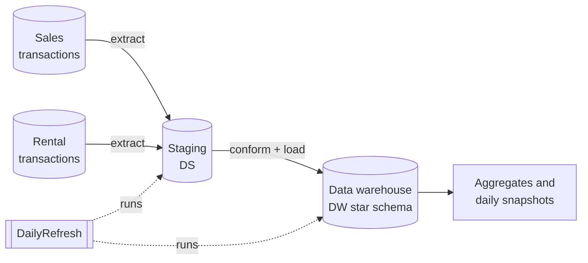
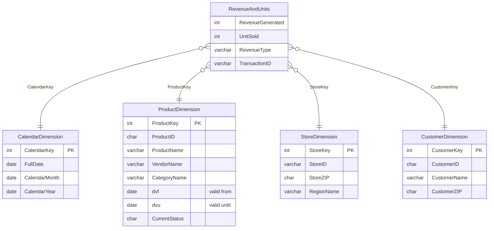

# Enterprise Analytical Data Warehouse

An analytics-ready data warehouse built end to end in SQL on MySQL. Separate operational systems (product sales and equipment rentals, each with its own tables and pricing rules) are extracted into a staging layer, conformed into a shared star schema, and kept current with incremental, late-arrival-safe refreshes. History is preserved with Slowly Changing Dimensions (Type 2), and pre-built aggregate and snapshot tables serve reporting.

**Stack:** SQL · MySQL · stored procedures · phpMyAdmin

**Dataset:** a retail sales-and-rentals data model (sample data).

## What it demonstrates

| Capability | How it is implemented |
|---|---|
| Multi-source integration | Sales and rental transaction systems (different tables, different price logic: unit price, daily rate, weekly rate) are merged into one conformed fact table |
| Layered architecture | Operational source → staging database (`DS`) → warehouse database (`DW`) |
| Dimensional modeling | Star schema: one revenue-and-units fact table shared by both business lines, with conformed Product, Customer, Store and Calendar dimensions |
| ETL | Initial load script, then stored procedures that extract from the source, stage, transform, and load into the warehouse |
| Incremental loading | Daily fact refresh loads only transactions newer than the last extraction timestamp |
| Late-arriving facts | A separate refresh finds transactions missing from the warehouse and loads them, so delayed records are not lost |
| Slowly Changing Dimensions (Type 2) | Product and Customer rows keep full history with valid-from / valid-until dates and a current-row flag, instead of being overwritten |
| Analytics-ready outputs | Product-category revenue aggregate and a daily store snapshot table, ready for BI tools and ad hoc SQL |
| Orchestration | One `DailyRefresh` procedure runs every dimension and fact refresh in the correct order |

## Architecture

`DailyRefresh` runs, in order: customer, product and store dimension refreshes → Type 2 refreshes for customer and product → regular daily fact refresh → late-arriving fact refresh.

## Star schema

Revenue is recorded by type (sales, daily rental, weekly rental), so one fact table serves both parts of the business.

## How the data moves

1. **Extract:** new sales and rental transactions are pulled from their separate source tables and standardized into one intermediate table (revenue type: sale, daily rental, weekly rental).
2. **Stage:** keys are resolved against the dimensions and the rows are inserted into the staging fact table, flagged as not yet loaded.
3. **Load:** flagged rows are inserted into the warehouse fact table and then marked as loaded.
4. **Handle changes:** when a product or customer attribute changes in the source, the Type 2 procedures close the old dimension row and insert a new current row, so history stays accurate.
5. **Catch late arrivals:** transactions that exist in the source but not in staging are loaded by the late-arriving fact refresh.

## Scripts

Run them in this order:

| # | Script | Purpose |
|---|---|---|
| 1 | `ZAGIMORE_DB_Creation.sql` | Creates the operational source database |
| 2 | `populateCalendarProcedure.sql` | Procedure that fills the calendar dimension |
| 3 | `ZAGIMORE_DS_Creation.sql` | Creates the staging area |
| 4 | `ZAGIMORE_DW_Creation.sql` | Creates the warehouse tables (star schema) |
| 5 | `ETL.sql` | Initial extract, transform and load |
| 6 | `Aggregates_Snapshots.sql` | Aggregate and snapshot tables |
| 7 | `Refreshes.sql` | Incremental dimension and fact refresh procedures |
| 8 | `Type2Changes_Refresh.sql` | Type 2 history for Product and Customer |
| 9 | `Procedures.sql` | Consolidated refresh procedures, including `DailyRefresh` |

## Running it

1. Install MySQL and phpMyAdmin (or use a hosted phpMyAdmin).
2. Clone the repository and open phpMyAdmin.
3. Run the scripts above in order. The database names in the scripts are prefixed with the original account name; change the prefix to match your environment.
4. After the initial load, call `DailyRefresh()` to run an incremental refresh.

## Contact

Vaibhav Alluri · vaibhav.sai5076@gmail.com · [LinkedIn](https://linkedin.com/in/vaibhavalluri) · [alluriv.dev](https://alluriv.dev)
